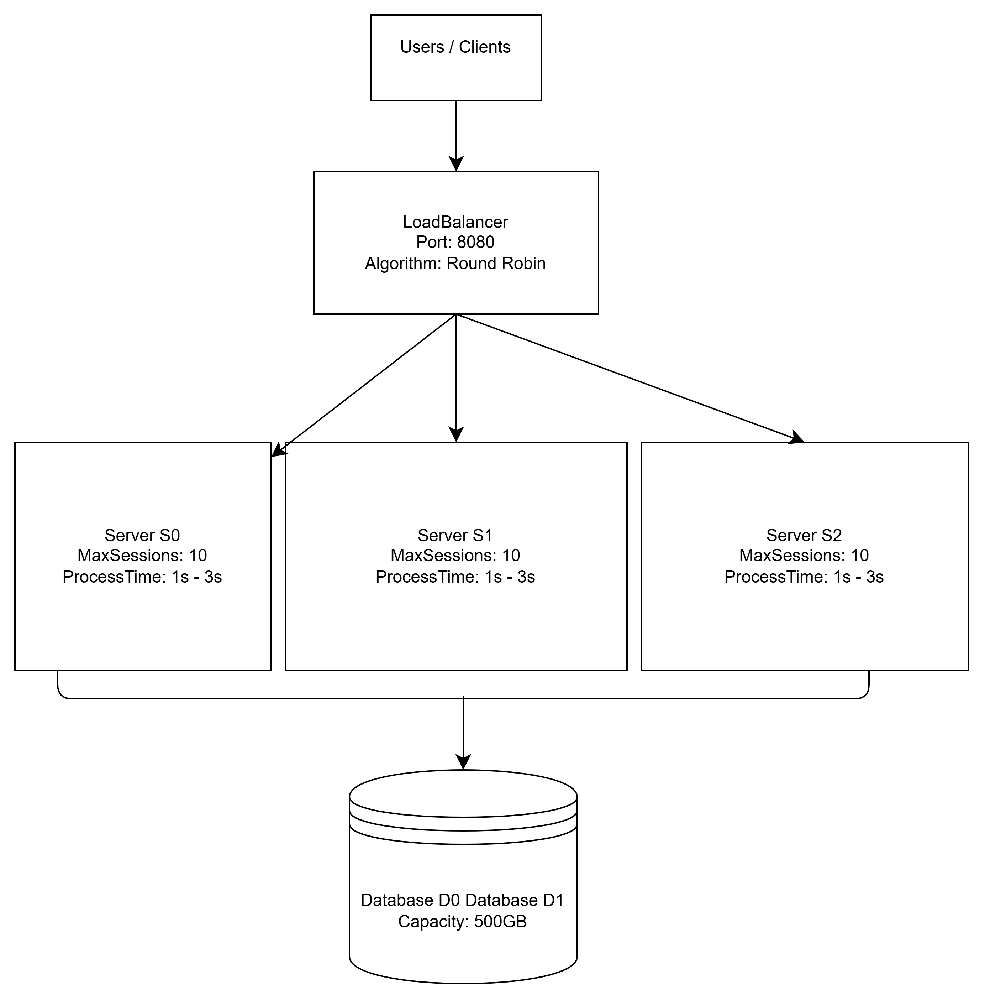

# System Design: Load Balancing Testbed
This is an implementation of a testbed for validating and optimizing load balancing in a system architectural design.

## Configuration

Configuration is currently defined in `MainTerminal.js`. Start the program with:

```sh
node MainTerminal.js
```

The console displays the current configuration and lets you change its values before choosing `Y` to start the load balancer. Changes apply only to the current run; they are not saved when the program exits.

After you choose `Y`, the program prints a startup message for the load balancer, followed by one entry for each backend server it creates. Backend ports and server limits are selected at runtime, so their values can differ between runs. The output is similar to:

```text
LoadBalancer is running on http://127.0.0.1:8080
Server {
  name: 'http://127.0.0.1:<port>',
  id: 'S0',
  maxSessions: <value>,
  processTime: <value>,
  sessions: []
}
```

It then periodically prints status objects for the servers (`id`, `Server`, `MaxSessions`, `processTime`, `Active`, and `limitReached`) and datastores (`id`, `Name`, `MaxStorage`, and `StorageLeft`). These values change as requests are handled. The current implementation schedules a status-printing timer for each backend server, so the full status output may repeat multiple times per interval. The program keeps running to serve requests; stop it with `Ctrl+C`.

The configuration has the following shape:

 ```yaml
 config = {
        LoadBalancingAlgorithm: <value>,
        NoServers: <value>,
        Replicas: <value>,
        MaxNoSessionsPerServer: <value>,
        MinNoSessionsPerServer: <value>,
        MaxProcessingTime: <value>, //seconds
        MinProcessingTime: <value>, //seconds
        NoDatastores: <value>,
        MaxDatastoreSpace: <value>, //GB
        MinDatastoreSpace: <value>, //MB
        MaxSizeRequestPayload: <value>, //MB
        MinSizeRequestPayload: <value>, //MB
    }
```

The testbed evaluates three load-balancing algorithms. These are `Round Robin`, `Least Connections` and `Consistent Hashing`. Given an configuration instance, the aim is to verify the limits of the system in its ability to be highly-available, resilient and to withstand a denial of service attack. 

The effectiveness of a configuration is measured by the frequency of server denial of access either due to lack of servers to handle new sessions or not enough space in the datastore to handle user request payload.


---
# Workshop 1 Implementation & Analysis

## Task A: Scaling Design

### A1. High-Level Architecture Diagram


### A2 & A5. Evaluation of Load Testing
We ran `RequestSimulation.js` with 3 servers, 2 databases, and a max of 10 sessions per server. 
- **Results:** At intervals from 500ms to 150ms, the success rate was 100%. As the interval dropped below 100ms, the system reached its limit, with the failure rate spiking to 100% at the 1ms interval.
- **Reason:** The server session limit was maxed out, and the datastore capacities were exhausted by the rapid, high-volume payload writes.

### A7. Scaling to Millions
To scale this to millions of users, the architecture requires horizontal scaling (e.g., Nginx cluster for Load Balancer), database sharding/caching (e.g., Redis), and asynchronous processing (e.g., Kafka message queues) to prevent server overload.

## Task B: Fault Tolerance & DDoS Defences

### 1. Fault Tolerance (Health Checks)
We modified `LoadBalancer.js` to simulate an S0 server crash every 15 seconds. The LoadBalancer detects this and drops S0 from rotation, returning a `503 Server DOWN` response to prevent connection timeouts, ensuring high availability.

### 2. Defences against Abusive Traffic
**Threat Model:** Oversized payloads and high-frequency burst traffic designed to exhaust storage and server sessions.
**Implementation:** 
1. Added a payload size limit in `LoadBalancer.js` (URL length > 100 returns `Payload Too Large`).
2. Added an IP-based rate limiter (max 20 requests/second).

**Evaluation (`AttackSimulation.js`):**
Normal requests passed. Oversized payloads were blocked. High-frequency attacks were blocked after the 20th request with `Rate Limit Exceeded`. This protects the backend from crashing, though rapid legitimate refreshes could be temporarily throttled.